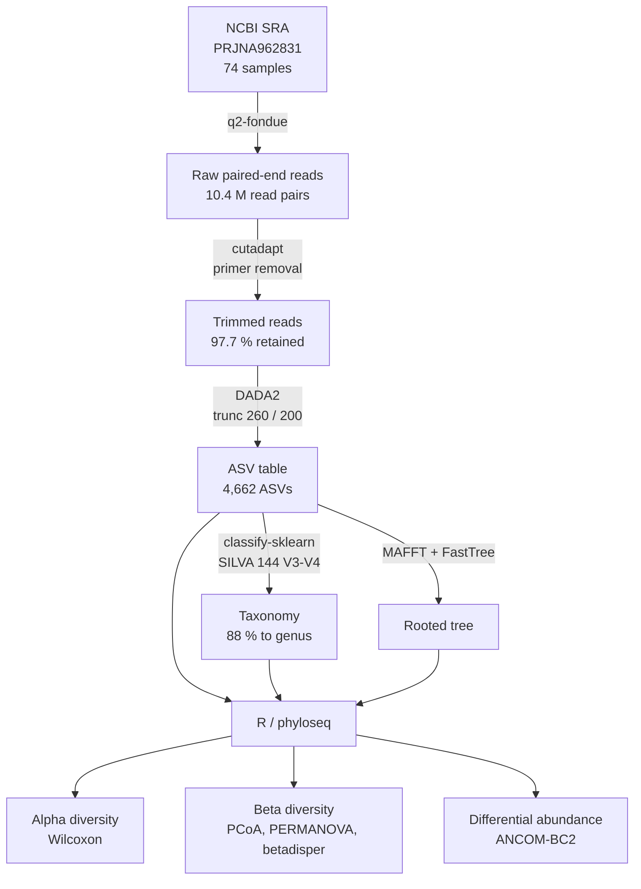
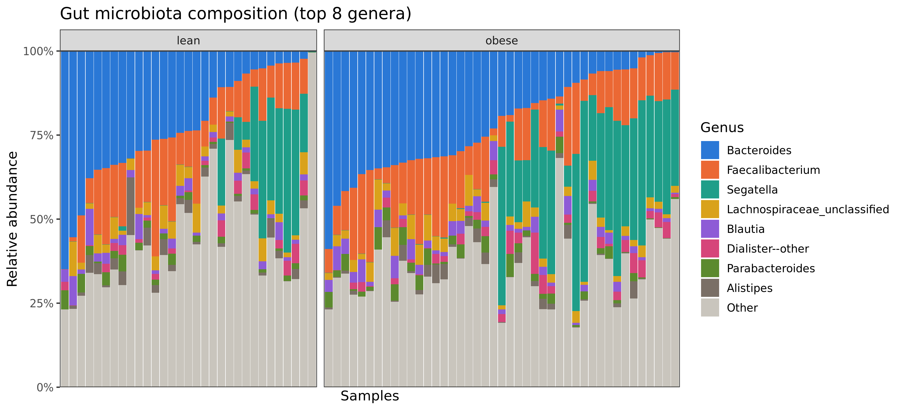
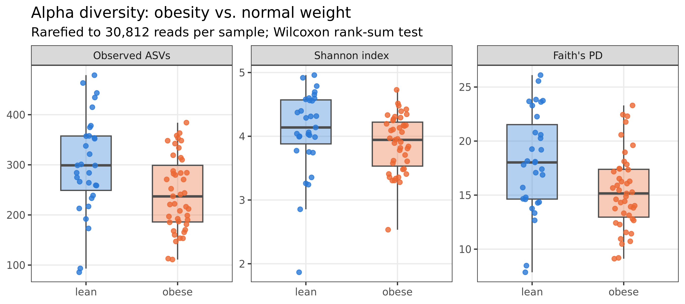
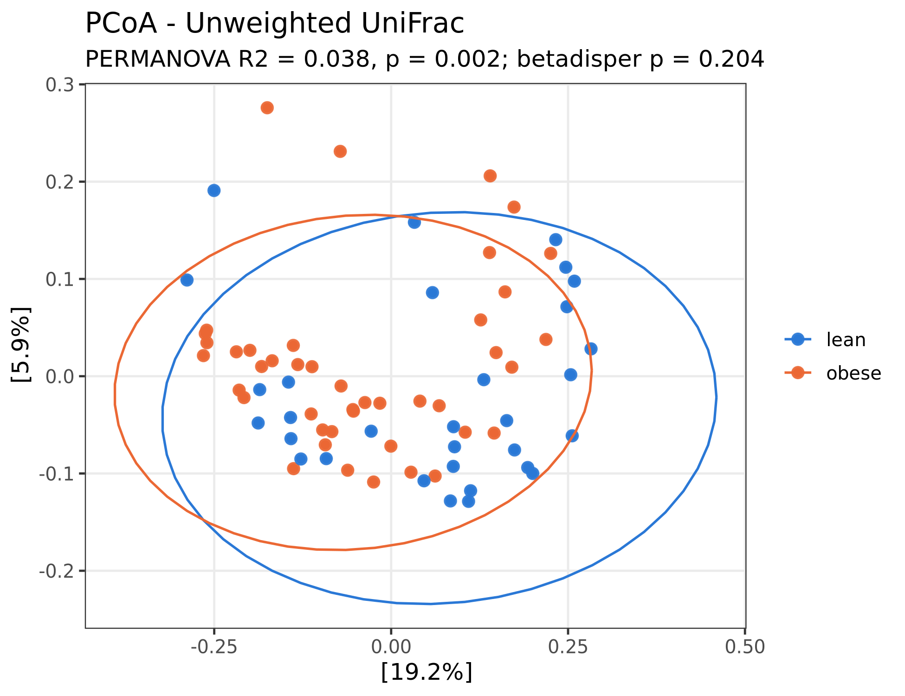
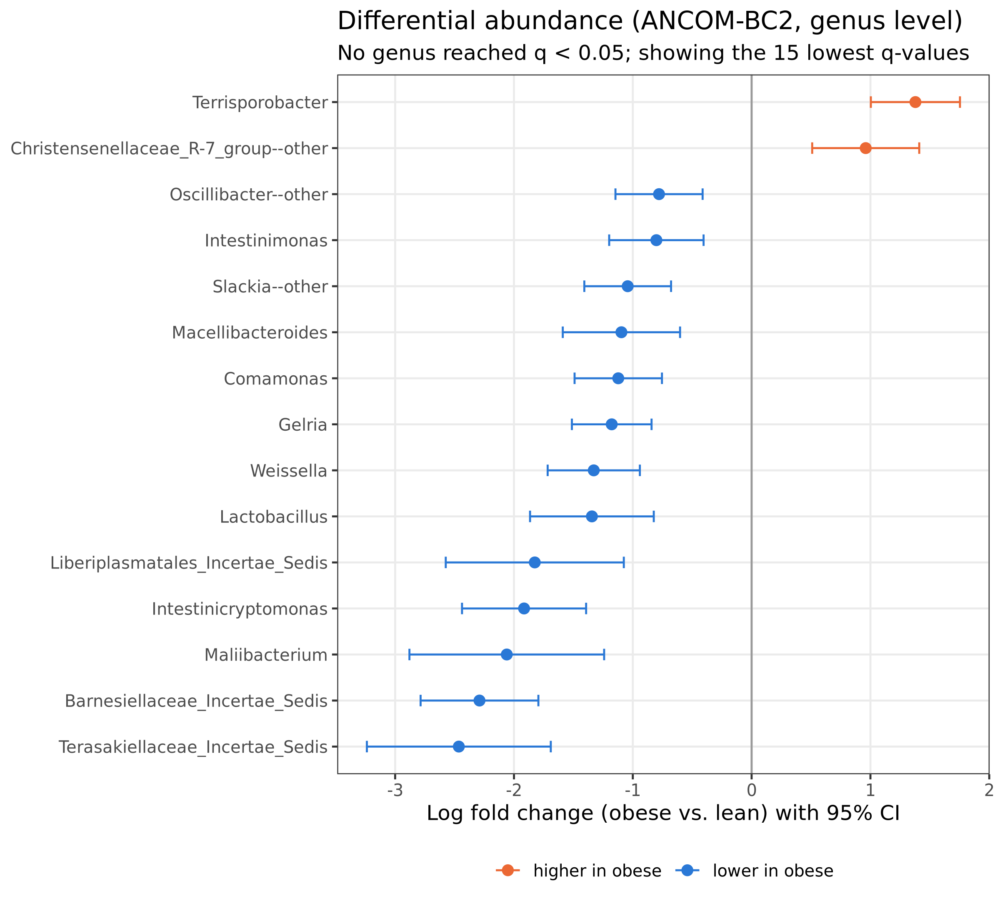

# Gut microbiota in adults with obesity vs. normal weight: a 16S rRNA reanalysis

Reanalysis of public 16S rRNA amplicon data (NCBI BioProject
[PRJNA962831](https://www.ncbi.nlm.nih.gov/bioproject/PRJNA962831)) with a fully
scripted, reproducible pipeline: **QIIME 2 → DADA2 → SILVA 144 → R/phyloseq → ANCOM-BC2**.

**Main finding.** Adults with obesity had a significantly **less diverse** gut
microbiota and a modest but significant shift in community composition. Taxa
previously linked to metabolic health (*Akkermansia*, *Christensenellaceae*,
*Alistipes*, *Odoribacter*) tended to be less abundant in obesity, but none remained
significant after FDR correction and sensitivity analysis.

---

## Contents

- [Project context](#project-context)
- [Data](#data)
- [Pipeline](#pipeline)
- [Key decisions](#key-decisions)
- [Results](#results)
- [Discussion](#discussion)
- [Reproducing the analysis](#reproducing-the-analysis)
- [Repository structure](#repository-structure)
- [References](#references)

---

## Project context

This is a learning project that grew out of a course assignment in
*Bioinformática aplicada al diagnóstico molecular* (Universidad Europea). The
assignment was to **design** (not run) an NGS study characterising the human gut
microbiota. Our design was a cross-sectional comparison of adults with obesity vs.
normal weight using 16S rRNA (V3–V4) amplicon sequencing on Illumina MiSeq, with a
QIIME 2 + R/phyloseq analysis pipeline.

To go one step further, this repository **implements that planned pipeline on real,
publicly available data** from a study with a very similar design (Ahmad et al., 2023).

**Hypothesis.** Adults with obesity have a less diverse gut microbiota and a lower
abundance of taxa associated with metabolic health (e.g. *Akkermansia*,
*Christensenellaceae*) than adults with normal weight.

- **H0:** no difference in alpha diversity (Shannon index) between groups.
- **H1:** alpha diversity is lower in the obesity group.

### Planned design vs. this reanalysis

| | Planned design | This reanalysis |
|---|---|---|
| Groups | 40 obese / 40 lean | 43 obese / 31 lean |
| Population | Adults, 18–60 years | Adults, United Arab Emirates |
| Covariates | Age, sex, BMI, waist, diet | Not available in public metadata |
| Primers | 341F / 805R (V3–V4) | 341F / 805R (confirmed in the reads) |
| Taxonomy database | SILVA 138.2 | SILVA 144 (newer release; original study: SILVA 132) |
| Alpha diversity | Observed, Chao1, Shannon, Faith PD | Observed, Shannon, Faith PD (Chao1 dropped, see [Key decisions](#key-decisions)) |
| Differential abundance | ANCOM-BC2 + second method | ANCOM-BC2 with sensitivity analysis |

---

## Data

Publicly available 16S rRNA gene amplicon data from:

> Ahmad, M. A., Karavetian, M., Moubareck, C. A., Wazz, G., Mahdy, T., & Venema, K. (2023).
> Association of the gut microbiota with clinical variables in obese and lean Emirati subjects.
> *Frontiers in Microbiology*, 14, 1182460. https://doi.org/10.3389/fmicb.2023.1182460

| | |
|---|---|
| Repository | NCBI Sequence Read Archive (SRA) |
| BioProject | [PRJNA962831](https://www.ncbi.nlm.nih.gov/bioproject/PRJNA962831) |
| Samples | 74 stool samples (adults, United Arab Emirates) |
| Target | 16S rRNA gene, V3–V4 region |
| Platform | Illumina MiSeq, 2 × 300 bp paired-end |

Raw reads and SRA metadata were retrieved with the QIIME 2 plugin
[q2-fondue](https://github.com/bokulich-lab/q2-fondue).

### Group labels (obese vs. lean)

The public SRA metadata do **not** include an explicit obesity status or BMI column.
Group labels were therefore **inferred from the sample codes** (`Isolate` field):

| Sample code pattern | n | Assigned group |
|---|---|---|
| `HMG…A`, `QH…A` (suffix "A") | 43 | obese |
| `H…`, `ZU…` (no suffix) | 31 | lean |

This 43/31 split matches exactly the group sizes reported in the original publication.
The suffix "A" is consistent with the pre-surgery time point of the bariatric pre–post
study the samples come from. However, this assignment is an **inference, not an
official label**, and has not been confirmed by the original authors.

---

## Pipeline



| Level | Step | Tool | Script |
|---|---|---|---|
| Primary | Download reads + metadata from SRA | q2-fondue | `scripts/01_download_data.sh` |
| | Infer group labels | Python / pandas | `scripts/02_make_metadata.py` |
| Secondary | Primer check | Python | `scripts/03_check_primers.py` |
| | Quality control, primer removal | `demux summarize`, cutadapt | `scripts/04_qiime2_processing.sh` |
| | Denoising, merging, chimera removal | DADA2 | `scripts/04_qiime2_processing.sh` |
| | Taxonomic classification | Naive Bayes classifier, SILVA 144 | `scripts/04_qiime2_processing.sh` |
| | Phylogenetic tree | MAFFT + FastTree | `scripts/04_qiime2_processing.sh` |
| Tertiary | Rarefaction, alpha and beta diversity | phyloseq, picante, vegan | `scripts/05_analysis.R` |
| | Differential abundance | ANCOM-BC2 | `scripts/05_analysis.R` |

---

## Key decisions

Every step involved choices. These are the ones that matter most, and why they were made.

**1. Primers were checked in the data, not assumed.**
The publication does not state the primer sequences. Inspecting the first reads
(`scripts/03_check_primers.py`) showed that the Illumina V3–V4 primers 341F/805R are
still present. Most R1 reads start with an **`N`** (an uncalled base in the first
sequencing cycle), so cutadapt was run with `--p-match-read-wildcards`.

**2. DADA2 truncation lengths: R1 = 260, R2 = 200.**
Chosen from the quality plots, where median quality starts to drop. After primer
removal the amplicon is ~426 nt, so 260 + 200 = 460 leaves ~34 nt of overlap
(DADA2 needs ≥ 12). The denoising statistics confirm the choice: merging lost only
~3 percentage points of reads.

**3. More RAM for DADA2.**
On 8 GB RAM, DADA2 failed with `'names' attribute must be the same length as the
vector` (a known, cryptic memory error). It ran successfully on 16 GB with 2 threads.

**4. Region-specific SILVA 144 classifier.**
The SILVA team's pre-trained V3–V4 (341f–806r) classifier was used; 805R and 806R
bind at nearly the same position. Its integrity was verified with the MD5 checksum
provided by SILVA.

**5. Unresolved genus names were relabelled.**
Placeholders such as `Incertae_Sedis` or `uncultured` occur in many unrelated families.
Aggregating by genus name alone would merge them (e.g. *Oscillospiraceae* and
*Christensenellaceae* "Incertae_Sedis"). They are therefore labelled with the next
informative rank (e.g. `Christensenellaceae_Incertae_Sedis`).

**6. Rarefaction depth: 30,812 reads.**
The smallest library after DADA2, so **no sample is lost**. The original study
rarefied to 3,800 reads; this reanalysis uses ~8× more reads per sample for diversity.

**7. Chao1 was dropped.**
Chao1 estimates unseen species from singletons, but DADA2 removes singletons, so
Chao1 is not meaningful for ASV data.

**8. Polytomies in the tree were resolved before UniFrac.**
phyloseq's UniFrac requires a strictly bifurcating tree; polytomies triggered a
warning and unreliable values, fixed with `ape::multi2di()`.

---

## Results

### Sequencing and quality control

| Step | Reads | |
|---|---|---|
| Raw read pairs | 10,431,663 | 40,221–357,170 per sample |
| After primer removal | 10,196,394 | 97.7 % retained |
| After DADA2 (non-chimeric) | 7,514,797 | 30,812–241,617 per sample (median 91,769) |

Mean per-sample retention through DADA2: 80.7 % passed filter, 77.6 % merged,
73.8 % non-chimeric
([`results/tables/dada2_denoising_stats.tsv`](results/tables/dada2_denoising_stats.tsv)).
DADA2 resolved **4,662 ASVs**, of which **88.1 %** were classified to genus level.

Interactive QIIME 2 visualisations (open in [view.qiime2.org](https://view.qiime2.org)):
[raw read quality](https://view.qiime2.org/?src=https://raw.githubusercontent.com/christinacaglioti/gut-microbiota-obesity-16s/main/results/demux_summary.qzv) ·
[trimmed read quality](https://view.qiime2.org/?src=https://raw.githubusercontent.com/christinacaglioti/gut-microbiota-obesity-16s/main/results/demux_trimmed_summary.qzv) ·
[feature table summary](https://view.qiime2.org/?src=https://raw.githubusercontent.com/christinacaglioti/gut-microbiota-obesity-16s/main/results/table-summary/summary.qzv)

### Taxonomic composition



*Bacteroides* (~22 %) and *Faecalibacterium* (~13 %) dominated in both groups. The
single most abundant ASV was a *Bacteroides*.

### Alpha diversity: lower in obesity ✅



| Metric | Median lean | Median obese | p (Wilcoxon) | q (BH) |
|---|---|---|---|---|
| Observed ASVs | 299 | 237 | 0.007 | **0.010** |
| Shannon index | 4.14 | 3.94 | 0.039 | **0.039** |
| Faith's PD | 18.0 | 15.2 | 0.006 | **0.010** |

All three metrics were significantly lower in the obesity group, so **H0 is rejected**.
This reproduces the main finding of the original study (lower Shannon diversity in obesity).

### Beta diversity: small but significant shift

| Distance | PERMANOVA R² | PERMANOVA p | betadisper p |
|---|---|---|---|
| Bray–Curtis | 0.020 | **0.033** | 0.415 |
| Unweighted UniFrac | 0.038 | **0.002** | 0.204 |
| Weighted UniFrac | 0.025 | 0.115 | 0.994 |



Community composition differed significantly between groups, while dispersion did not
(betadisper n.s.), so the PERMANOVA result reflects a shift in composition rather than
in variability. Group membership explained only **2–4 %** of the variation.

### Differential abundance (ANCOM-BC2)

No genus was differentially abundant after FDR correction **and** the sensitivity
analysis for pseudo-counts. Results for the hypothesis taxa
(LFC < 0 = lower in obesity; natural log scale):

| Taxon | Level | LFC (obese vs. lean) | q | Passed sensitivity |
|---|---|---|---|---|
| *Akkermansia* | genus | −0.92 | 0.20 | yes |
| *Christensenellaceae* | family | −0.40 | 0.22 | yes |
| *Alistipes* | genus | −0.68 | 0.24 | yes |
| *Odoribacter* | genus | −0.80 | 0.042 | **no** |
| *Segatella* (formerly *Prevotella copri*) | genus | +1.10 | 0.33 | yes |
| *Lachnospira* | genus | −0.06 | 0.93 | yes |



Full results: [`ancombc2_genus.tsv`](results/tables/ancombc2_genus.tsv),
[`ancombc2_family.tsv`](results/tables/ancombc2_family.tsv),
[`hypothesis_taxa.tsv`](results/tables/hypothesis_taxa.tsv).

---

## Discussion

**Diversity.** The loss of diversity in obesity was robust across three alpha
diversity metrics. The beta diversity pattern adds a nuance: the shift was detected
by **unweighted** UniFrac (presence/absence of lineages) but not by **weighted**
UniFrac (dominated by abundant taxa). This suggests that obesity is associated mainly
with the **loss of less abundant lineages**, while the dominant genera are similar.

**Individual taxa.** The direction of change for *Akkermansia*, *Christensenellaceae*,
*Alistipes* and *Odoribacter* agrees with previous studies (Goodrich et al., 2014;
Lin et al., 2023), but the effects were not significant. With 74 participants and the
large variation between individuals, the study is likely underpowered for
genus-level differences.

**Comparison with the original study.** The original study reported higher
*Lachnospira* in obesity using LEfSe. This reanalysis found no difference with
ANCOM-BC2, which accounts for the compositional nature of the data and controls the
false discovery rate. Method choice can change differential abundance results
substantially, which is one reason why genus-level findings in obesity are
inconsistent across studies (Pinart et al., 2022).

### Limitations

- **Group labels are inferred** from sample codes, not provided in the public metadata.
- **Cross-sectional design:** association, not causation.
- **No covariates** (BMI, diet, medication, age, sex) were available for adjustment.
- **16S amplicons** resolve genera, not species, and do not measure function.
- A **single population** (United Arab Emirates); results may not generalise.

---

## Reproducing the analysis

The analysis was run in a [GitHub Codespace](https://github.com/features/codespaces)
(Linux, 4 cores / 16 GB RAM for DADA2 and taxonomy; 2 cores for the rest).

**1. Software environments**

```bash
# QIIME 2 (rachis) 2026.10, amplicon distribution
conda env create \
  --name rachis-qiime2-2026.10 \
  --file https://raw.githubusercontent.com/qiime2/distributions/refs/heads/dev/2026.10/qiime2/released/rachis-qiime2-linux-64-conda.yml

# R environment for the downstream analysis
conda create -y -n r-microbiome -c conda-forge -c bioconda \
  r-base bioconductor-phyloseq bioconductor-biomformat bioconductor-ancombc \
  bioconductor-microbiome r-vegan r-picante r-ggplot2 r-dplyr r-tidyr
```

**2. Run the pipeline**

```bash
conda activate rachis-qiime2-2026.10
bash scripts/01_download_data.sh your.email@example.com   # NCBI requires an e-mail
python scripts/02_make_metadata.py
python scripts/03_check_primers.py
bash scripts/04_qiime2_processing.sh                      # several hours (DADA2)

conda activate r-microbiome
Rscript scripts/05_analysis.R
```

To reproduce only the statistical analysis, skip steps 01–04: the processed data
needed by `05_analysis.R` are included in `results/processed/`.

Large intermediate files (raw reads, QIIME 2 artifacts) are not tracked
(see `.gitignore`). Package versions of the R session are recorded in
[`results/sessionInfo_R.txt`](results/sessionInfo_R.txt).

---

## Repository structure

```
├── metadata/
│   ├── ids.tsv                     # BioProject accession for q2-fondue
│   └── sample-metadata.tsv         # sample IDs and inferred groups
├── scripts/
│   ├── 01_download_data.sh
│   ├── 02_make_metadata.py
│   ├── 03_check_primers.py
│   ├── 04_qiime2_processing.sh
│   └── 05_analysis.R
├── results/
│   ├── processed/                  # feature-table.biom, taxonomy.tsv, tree.nwk
│   ├── figures/                    # PNG figures
│   ├── tables/                     # result tables (TSV)
│   └── *.qzv                       # QIIME 2 visualisations
└── data/                           # large files, not tracked
```

---

## References

- Ahmad, M. A. et al. (2023). Association of the gut microbiota with clinical variables in obese and lean Emirati subjects. *Frontiers in Microbiology*, 14, 1182460.
- Bolyen, E. et al. (2019). Reproducible, interactive, scalable and extensible microbiome data science using QIIME 2. *Nature Biotechnology*, 37, 852–857.
- Callahan, B. J. et al. (2016). DADA2: High-resolution sample inference from Illumina amplicon data. *Nature Methods*, 13, 581–583.
- Goodrich, J. K. et al. (2014). Human genetics shape the gut microbiome. *Cell*, 159, 789–799.
- Lin, H. & Peddada, S. D. (2024). Multigroup analysis of compositions of microbiomes with covariate adjustment and repeated measures. *Nature Methods*, 21, 83–91.
- Lin, Y. et al. (2023). Combing fecal microbial community data to identify consistent obesity-specific microbial signatures and shared metabolic pathways. *iScience*, 26, 106476.
- Martin, M. (2011). Cutadapt removes adapter sequences from high-throughput sequencing reads. *EMBnet.journal*, 17, 10–12.
- McMurdie, P. J. & Holmes, S. (2013). phyloseq: An R package for reproducible interactive analysis and graphics of microbiome census data. *PLoS ONE*, 8, e61217.
- Pinart, M. et al. (2022). Gut microbiome composition in obese and non-obese persons: A systematic review and meta-analysis. *Nutrients*, 14, 12.
- Quast, C. et al. (2013). The SILVA ribosomal RNA gene database project: improved data processing and web-based tools. *Nucleic Acids Research*, 41, D590–D596.
- Ziemski, M. et al. (2022). q2-fondue: reproducible and FAIR retrieval of sequencing data and metadata. *Bioinformatics*.

---

**Author:** Christina Caglioti · **License:** MIT (code). The sequencing data belong
to the original authors and are available from NCBI SRA under BioProject PRJNA962831.